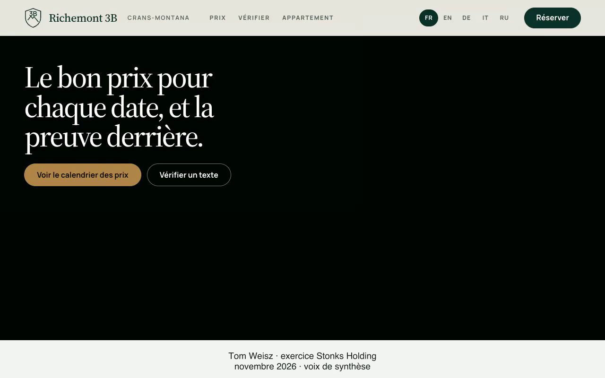
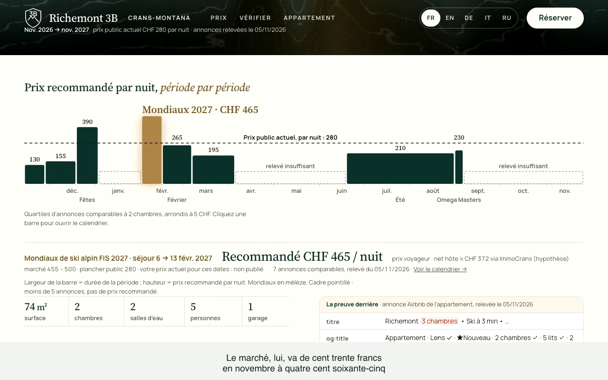
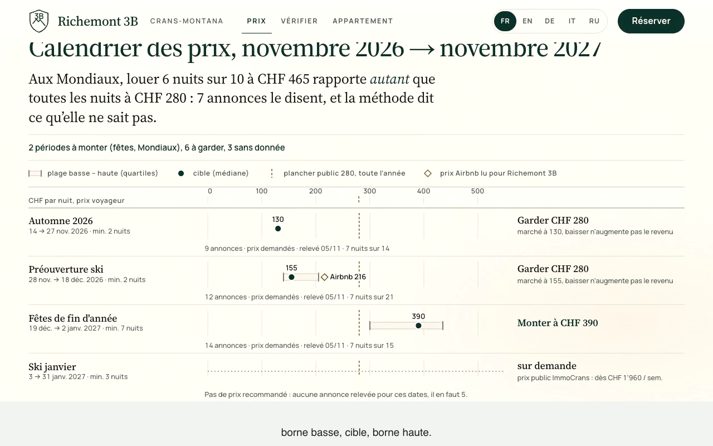
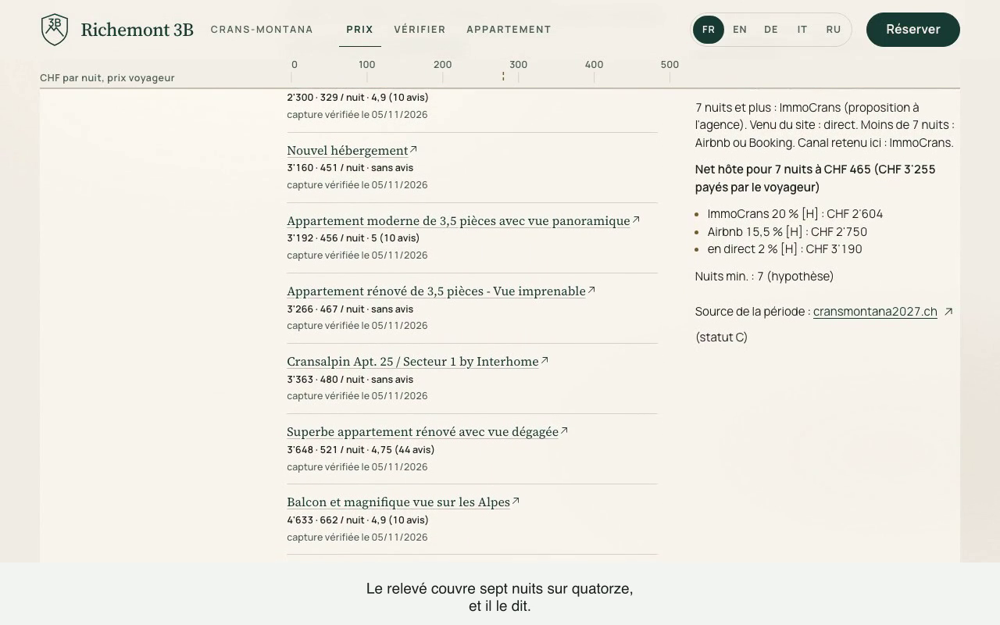
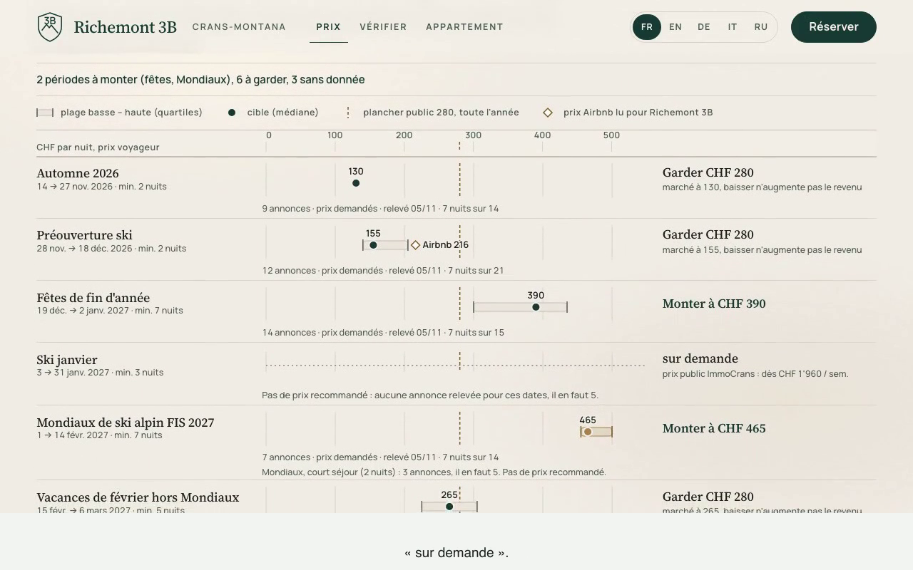
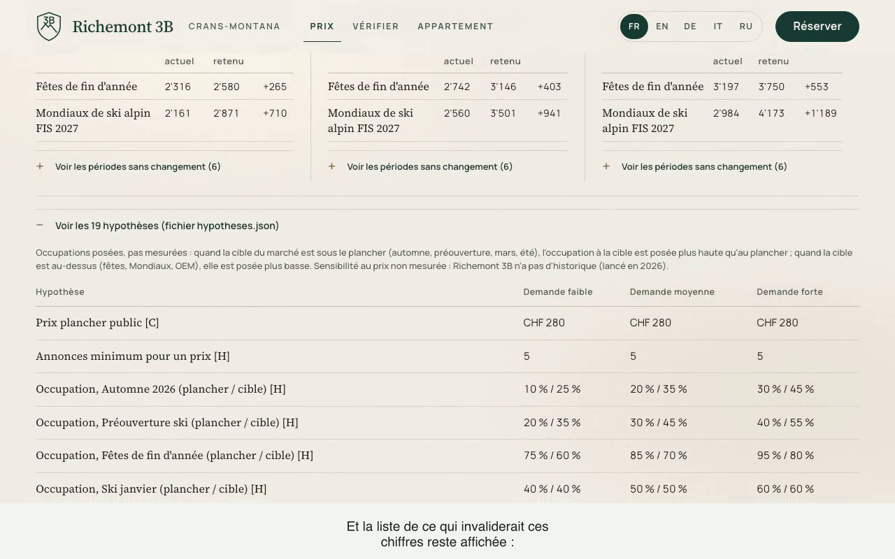
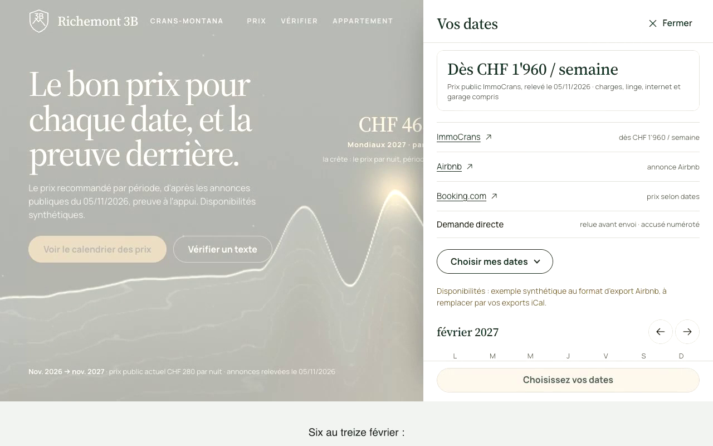
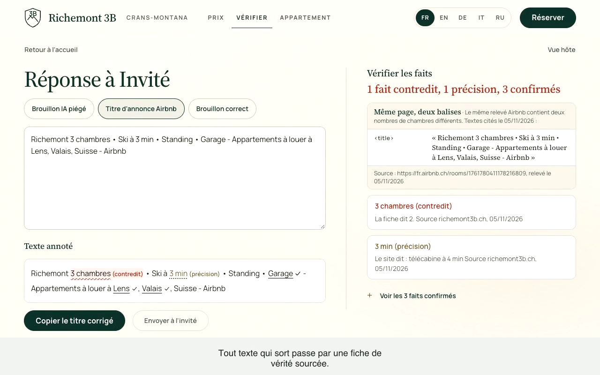
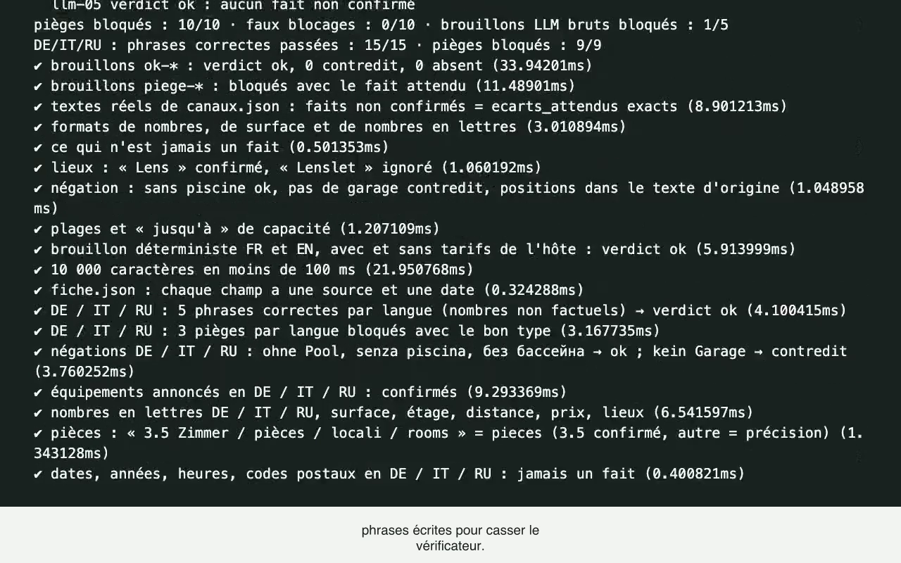
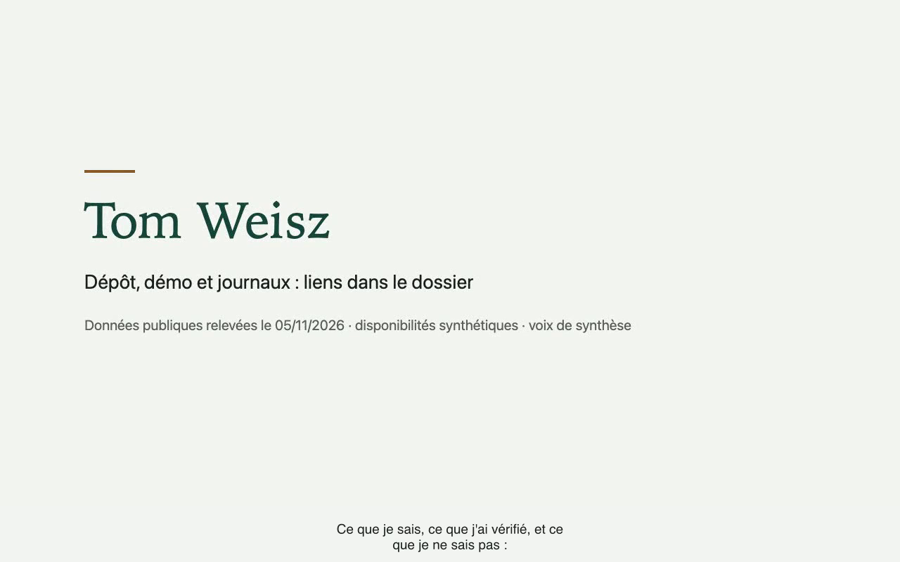

# Storyboard (rendu refait après la refonte visuelle : mêmes plans, mêmes voix, images ci-dessous extraites du rendu final) · Richemont 3B · Tom Weisz

Plans 1, 2, 3, 7, 8 réenregistrés après le passage de l'accueil à la scène de nuit (WebGL, rendu logiciel SwiftShader, sur une deuxième machine : le rendu logiciel saccade sur la première) ; voix inchangées. Images extraites du rendu final `video/demo-tom-weisz-richemont3b.mp4` (1280×800, bandeau de sous-titres sous l'image).

## Durées

| Plan | Vidéo brute (s) | Voix (s) | Finale (s) |
|---|---|---|---|
| 1 | 3.0 | muet | 3.0 |
| 2 | 20.0 | 19.52 | 20.12 |
| 3 | 22.0 | 25.84 | 26.44 |
| 4 | 22.0 | 22.96 | 23.56 |
| 5 | 11.97 | 9.84 | 11 |
| 6 | 22.0 | 18.24 | 21 |
| 7 | 24.0 | 22.24 | 23.2 |
| 8 | 26.0 | 23.6 | 24.8 |
| 9 | 16.0 | 14.24 | 15.3 |
| 10 | 12.0 | 6.72 | 8 |

Total : 176,5 s (plan 3 raccourci après reformulation d’une phrase) (voir `ffprobe` du fichier final). Règle : finale = max(voix + 0,6 s ; min(vidéo ; plafond)) ; plafonds de rognage de la fin statique : plan 5 = 11 s, 6 = 21 s, 7 = 23,2 s, 8 = 24,8 s, 9 = 15,3 s, 10 = 8 s (pour tenir ≤ 2:58). Plans 2, 3, 4 prolongés par image figée. Voix démarrant à 0,3 s.

## Plans

### Plan 1 · Ouverture sur la scène de nuit

- Texte dit : — (silence, puis la phrase 2 commence à 0:02)
- À l'écran : scène de nuit ; la crête se trace puis le pic « CHF 465 » (Mondiaux 2027 · par nuit) s'allume ; bandeau fixe « Tom Weisz · exercice Stonks Holding · novembre 2026 · voix de synthèse »
- Nombres relus contre l'écran (images ouvertes) : 465 vu (en or au-dessus du pic) · 280 vu (pied de page) · tracé de la crête vu à 0,3 / 0,8 / 1,5 s (`captures/apres/video-plan1-t*.png`)

### Plan 2 · Accueil : scène de nuit puis graphe

- Texte dit : Voix de synthèse. Je suis Tom Weisz. Richemont 3B est un appartement à Crans-Montana. Son seul prix public est un plancher : deux cent quatre-vingts francs la nuit, toute l'année. Le marché, lui, va de cent trente francs en novembre à quatre cent soixante-cinq pendant les Mondiaux de ski. Et aucun prix n'a de preuve.
- À l'écran : 5 s sur la scène de nuit (souris immobile), défilement doux de 3 s, puis le graphe avec les barres qui montent, « Prix public actuel, par nuit : 280 » en pointillé, 130, « Mondiaux 2027 · CHF 465 » en or, vignette « Recommandé CHF 465 / nuit »
- Nombres relus contre l'écran (images extraites ouvertes) : 280 vu (pointillé et pied de page de la scène) · 130 vu (première barre) · 465 vu (scène, barre en or, vignette « Recommandé CHF 465 / nuit ») · 455 – 500 vu · 1'960 non vu (vu plan 7)

### Plan 3 · Clic « Voir le calendrier des prix » → vue calendrier (barres en cascade)

- Texte dit : Voici un calendrier de prix sur onze périodes. Chaque barre vient d'annonces publiques comparables, relevées le cinq novembre : borne basse, cible, borne haute. La phrase du haut dit l'essentiel : aux Mondiaux, six nuits sur dix à quatre cent soixante-cinq rapportent autant que toutes les nuits à deux cent quatre-vingts. Et chaque période a sa décision : monter, ou garder le plancher.
- À l'écran : Vue calendrier : phrase du seuil, « 2 périodes à monter (fêtes, Mondiaux), 6 à garder, 3 sans donnée », légende, 11 lignes avec barres, trait plancher 280, décisions à droite
- Nombres relus contre l'écran (images ouvertes) : 130 vu · 05/11 vu · 6 nuits sur 10 vu · 465 vu · 280 vu · 2 à monter, 6 à garder, 3 sans donnée vu · 11 périodes non vu (8 à 9 lignes lisibles par image, pas de compteur)

### Plan 4 · Clic sur la période Mondiaux → détail déplié

- Texte dit : Je clique sur les Mondiaux. Sept annonces à deux chambres, avec lien, total lu, prix par nuit et avis. Les captures sont conservées hors dépôt, leur empreinte est là. Le relevé couvre sept nuits sur quatorze, et il le dit. Canal recommandé : ImmoCrans dès sept nuits, avec le net hôte, commissions affichées comme hypothèses.
- À l'écran : Détail Mondiaux : « 7 annonces », liste, « capture vérifiée », empreinte SHA-256, « 7 nuits sur 14 », « Canal recommandé », net hôte ImmoCrans 20 % [H]
- Nombres relus contre l'écran (images ouvertes) : 7 annonces vu · 7 nuits sur 14 vu · 2'604 vu · 20 % vu · 465 vu

### Plan 5 · Défilement vers « Ski janvier » (sur demande)

- Texte dit : En janvier, aucune annonce n'a été relevée pour ces dates. Alors il n'y a pas de prix recommandé : « sur demande ». On n'invente pas un chiffre pour remplir une case.
- À l'écran : Ligne « Ski janvier » : pointillé, « sur demande », « Pas de prix recommandé : aucune annonce relevée pour ces dates, il en faut 5. »
- Nombres relus contre l'écran (images ouvertes) : 5 vu (« il en faut 5 »)

### Plan 6 · Défilement vers le bloc Gain

- Texte dit : Ce que ça change, en net pour l'hôte, selon trois scénarios de demande. Toutes les hypothèses sont visibles et modifiables. Et la liste de ce qui invaliderait ces chiffres reste affichée : annonces déjà réservées invisibles, prix demandés et non obtenus, mandat de l'agence.
- À l'écran : Bloc Gain : seuils, trois colonnes « Demande faible / moyenne / forte », « Hiver 2026-27 · net hôte : … », « Voir les 19 hypothèses », « Ce qui invaliderait ces chiffres » (8 points)
- Nombres relus contre l'écran (images ouvertes) : +975 vu · +1'344 vu · +1'742 vu · 19 hypothèses vu · 8 points vu (8 puces comptées)

### Plan 7 · Clic « Réserver » → panneau, dates 6 → 13 février 2027

- Texte dit : Côté visiteur, le bouton « Réserver » affiche les nuits libres et le prix. Six au treize février : le prix public ImmoCrans reste la référence, le repère marché est donné, trois mille deux cent cinquante-cinq francs pour sept nuits, à confirmer par l'agence, avec sa preuve. La demande est relue avant l'envoi, et un doublon est bloqué.
- À l'écran : Panneau : calendrier des nuits, clic 6 puis 13 février, « Via ImmoCrans · prix public dès CHF 1'960 / semaine », « Repère marché : CHF 3'255 (7 nuits à 465), à confirmer par l'agence », preuve « 7 annonces relevées le 05/11/2026 »
- Nombres relus contre l'écran (images ouvertes) : 6 → 13 février vu · 1'960 vu · 3'255 vu · 465 vu · 7 annonces vu · 05/11/2026 vu

### Plan 8 · Vue « Vérifier un texte », bouton « Titre d'annonce Airbnb »

- Texte dit : Tout texte qui sort passe par une fiche de vérité sourcée. Je colle le titre réel de l'annonce Airbnb : « trois chambres ». La même page dit « deux chambres » dans une autre balise ; la fiche dit deux. Un brouillon qui parle d'une piscine est bloqué. Un prix hors des bornes de sa période devient une précision à apporter. En cinq langues.
- À l'écran : Vue vérificateur : titre Airbnb annoté, « 3 chambres » en rouge « contredit », encart « Même page, deux balises » (`<title>` / `og:title`), carte « La fiche dit 2. Source richemont3b.ch, 05/11/2026 » ; puis « Brouillon IA piégé » : « piscine » absent
- Nombres relus contre l'écran (images ouvertes) : 3 chambres vu · 2 chambres vu · 05/11/2026 vu

### Plan 9 · Terminal : `npm test`

- Texte dit : Cent cinquante-sept tests, sans rien installer : quartiles recalculés, dates, doublons, corpus figé avant le code, soixante-sept phrases écrites pour casser le vérificateur. Et trente-huit contrôles de bout en bout.
- À l'écran : Terminal : `npm test` … « tests 157 · pass 157 · fail 0 », lignes « sondage post-gel : 67 réussies / 0 ratées », « pièges bloqués : 10/10 »
- Nombres relus contre l'écran (images ouvertes) : 157 vu · 67 vu (image à 5 s du plan) · 10/10 vu · 38 vu (« 38/38 contrôles OK en 63.9 s »)

### Plan 10 · Carte de fin

- Texte dit : Ce que je sais, ce que j'ai vérifié, et ce que je ne sais pas : tout est dans le dépôt. Merci.
- À l'écran : « Tom Weisz » « Dépôt, démo et journaux : liens dans le dossier » « Données publiques relevées le 05/11/2026 · disponibilités synthétiques · voix de synthèse »
- Nombres relus contre l'écran (images ouvertes) : —

## Points signalés (état au rendu final)

- Plan 6 : le tableau des 19 hypothèses affichait « 1000 % / 2500 % » (pourcentage appliqué deux fois dans `prototype/app.js`) : **corrigé**, plan ré-enregistré, l'image ci-dessus montre « 10 % / 25 % » ; 157 tests et 38 contrôles relancés.
- Plan 8 : le prénom fictif de la démo était « Giulia » : **remplacé par « Invité »**, plan ré-enregistré. Aucun nom de personne autre que Tom Weisz.
- Plan 7 : d'abord enregistré avec une interception de l'iCal : **refait sans**, le fichier réel libère la semaine du 6 au 13 février.
